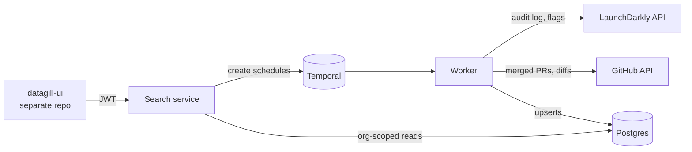

```
      /`·.¸
     /¸...¸`:·
 ¸.·´  ¸   `·.¸.·´)
: © ):´;      ¸  {
 `·.¸ `·  ¸.·´\`·¸)
     `\\´´\¸.·´

    d a t a g i l l
```

**Measure engineering impact by what ships, not by PR counts.**

> **Status:** early-stage side project. No production users yet. APIs, schema, and docs
> may change without notice.

---

## Why we built this

We are two engineers who got tired of seeing engineers measured by PR counts and token
usage. Those numbers are easy to collect, and they tell you very little about whether
anything got better for users.

On payments teams we saw a much better signal: **feature-flag launches**. A flag going
live in production is the moment work actually reaches customers. It's how teams ship
risky changes safely, and it maps closely to real progress and impact.

DataGill is our attempt to make that signal measurable. It ingests flag changes from your
flag provider and merged pull requests from GitHub, and connects them, so each launch can
be traced back to the PRs behind it.

## What works today

Everything listed here is in this repository and covered by tests.

- **LaunchDarkly ingestion.** Polls the audit log and flag details, keeps every raw response,
  and normalizes them into canonical `feature_flags` and `feature_flag_changelog` tables.
- **GitHub PR ingestion and enrichment.** A GitHub App ingests merged pull requests. An
  enrichment workflow then scans each PR's diff for known flag keys and records which flags
  the PR **added** and which it **removed**.
- **Activity timeline.** An org-wide, newest-first feed of flag changes (who changed which
  flag, when, and in which environments), filterable by team and actor. There's a separate
  feed of merged PRs showing each PR's flag references. The two are not yet merged into one
  stream.
- **Analytics** (served from `GET /v1/analytics?metric=...`):
  - `launched_wins`: flags that went live in production in a date range, filterable by team
    or actor.
  - `top_teams`: teams ranked by flag change activity. Team comes from the flag's
    maintainer team in LaunchDarkly.
  - `velocity`: an org-wide average time-to-rollout for flags now at 100%. This is a rough
    signal. It measures from when DataGill first stored the flag, not from when the flag was
    created in LaunchDarkly, and it isn't broken down by team yet.
  - `audit_log` and `pull_requests`: the feeds above.
- **Multi-tenant, durable pipelines.**
  - Every query and every deterministic key is scoped by `org_id`.
  - Each integration gets its own Temporal schedule for ingestion, and each org gets one
    schedule for PR enrichment.
  - All writes are idempotent upserts, so any workflow or activity can be retried or
    replayed safely.
  - Sync cursors only advance after a successful run.

### Questions it answers

| Question | Status |
|----------|--------|
| What flags changed in the last N hours, by whom, and in which environments? | ✅ Today |
| Which flags launched in production this month, and who launched them? | ✅ Today |
| Which teams have the most flag activity? | ✅ Today |
| Roughly how long does it take us to get a flag to full rollout? | ⚠️ Rough, org-wide only (see `velocity` above) |
| Which flag keys did each merged PR add or remove? | ✅ Today |
| Which PRs are behind this specific flag launch? | Roadmap. The data is linked, but there's no launch → PR view yet. |
| Was a change made by a human or an automated token? | Roadmap |
| Was this change a rollback? | Roadmap |
| Which flags are stale and safe to clean up? | Roadmap |
| What did each change do: bug fix, feature, or improvement? | Roadmap |
| What was our biggest win last quarter, and which team owned it? | Roadmap |
| Did that flag change correlate with a metric anomaly? | Roadmap |

## Architecture

Two Go binaries share one Postgres database and one Temporal cluster:

| Component | Path | Role |
|-----------|------|------|
| **Search service** | `services/search` | HTTP API (Chi) on `:8082`. Verifies JWTs, manages integrations, creates Temporal schedules, serves analytics. Holds no sync logic. |
| **Worker** | `cmd/worker` | Runs every Temporal workflow and activity: extract, normalize, save, enrich. |
| **App Postgres** | `db/migrations` | Raw `source_records` plus the canonical tables. |
| **Temporal** | `docker-compose.yml` | Schedules, durable execution, retries. Has its own Postgres. |



**How data flows: ingestion → enrichment → timeline**

1. **Schedule.** When an integration is connected, the search service creates a Temporal
   schedule (`etl-<integration>`, every 30 min) that starts `FeatureFlagETLWorkflow`.
   The workflow exits without doing anything if the integration is paused or deleted.
   Otherwise it routes to the provider's extract workflow.
2. **Ingest.** `LaunchDarklyExtractWorkflow` and `GitHubExtractWorkflow` page through the
   provider API from `integrations.last_synced_at`. They save each raw response to the
   append-only `source_records` table, then normalize and upsert into the canonical tables:
   `feature_flags`, `feature_flag_changelog` and `pull_requests`. The cursor moves forward
   only after the whole window is saved.
3. **Enrich.** Saving a PR also queues a `pull_request_enrichments` row in the same
   transaction. A per-org `GitHubEnrichmentWorkflow` claims pending rows, fetches each
   diff, and records the flag keys the PR added or removed. Failures back off across runs,
   from 30 minutes up to 24 hours.
4. **Serve.** The UI calls `GET /v1/analytics?metric=...`. Each metric is a small plugin
   that runs an org-scoped SQL query over the canonical tables.

More detail on design decisions and trade-offs is in [`AGENTS.md`](./AGENTS.md).

## Vision / Roadmap

> **None of this is built yet.** This section describes where we want to take DataGill.

- **Understand each change.**
  - Use an LLM to classify every change as a bug fix, feature, or improvement.
  - Write a short summary of what each change did.
  - Map changes to the projects they belong to.
- **Ask questions in plain language.**
  - Semantic search over the timeline, using pgvector and embeddings behind a swappable
    `EmbedProvider` interface.
  - Example questions: *"What was our biggest win last quarter, and which team owned it?"*
    and *"Which teams need more help shipping impactful work?"*
- **Privacy by default.** Today the API returns actor-level data, such as who launched a
  flag, to any member of the org. The planned model:
  - Leaders see **team-level aggregates only**.
  - Each person sees **their own** data.
  - Individual data is shared only by that person's choice, for example when they're
    building a promotion document.
  - Aggregates are shown only for teams above a minimum size, so individuals can't be
    singled out.
- **More sources.**
  - Flag providers: PostHog, Statsig, Unleash, Flagsmith.
  - Incidents and metrics: PagerDuty, Datadog.
  - Project trackers: Jira, Linear.
- **Smarter flag analytics.** Detect human vs. automated changes and rollbacks, list stale
  and dead flags, and compute per-team velocity.

## Local development

### Prerequisites

| Tool | Version |
|------|---------|
| Go | 1.26 (see `go.work`) |
| Docker with Compose v2 | recent |
| [golang-migrate](https://github.com/golang-migrate/migrate) | 4.x (`brew install golang-migrate`) |
| [golangci-lint](https://golangci-lint.run/) | v1.64.8, only needed for `make lint` |

The web UI lives in a **separate repository**, `datagill-ui`. The commands below assume it
is checked out next to this one as `../datagill-ui`. The search service fetches signing keys
(JWKS) from the UI's auth server on startup and **exits if it can't reach them**. Start
`datagill-ui` first if you want the API to stay up. The worker, databases, and Temporal run
without it.

### Quick start

```bash
cp .env.example .env
# Set ENCRYPTION_KEY in .env (required):
openssl rand -hex 32

make docker-up                        # Postgres, Temporal, observability, search, worker
set -a && source .env && set +a
make migrate                          # apply db/migrations to app-postgres

curl http://localhost:8082/healthz    # {"service":"search","status":"ok"} once datagill-ui is up
```

| Service | URL |
|---------|-----|
| Search API | http://localhost:8082 |
| Temporal UI | http://localhost:8080 |
| Grafana | http://localhost:3000 (admin / admin) |
| Prometheus | http://localhost:9090 |
| DataGill UI (from `datagill-ui`) | http://localhost:3001 |

GitHub ingestion requires your own GitHub App. The `GITHUB_APP_*` variables are described
in [`LOCALSETUP.md`](./LOCALSETUP.md), along with running the services with `go run` and
troubleshooting.

### Tests, lint, build

```bash
make test-unit   # unit tests, no external dependencies
make test-int    # integration tests; needs Docker (testcontainers)
make lint        # golangci-lint across all modules
make build       # builds bin/worker and bin/search
make vuln        # govulncheck, per module
```

### Seeding demo data

After you sign up in the UI and connect an integration, you can fill the dashboard with demo
flags and changelog events:

```bash
# Find your org and integration keys
psql "$APP_DATABASE_URL" -c "SELECT key, external_org_id FROM organizations;"
psql "$APP_DATABASE_URL" -c "SELECT key, org_id, source FROM integrations;"

go run ./cmd/seed \
  --db-url "$APP_DATABASE_URL" \
  --org-id "<organizations.key>" \
  --integration-id "<integrations.key>"
```

The seed script is idempotent, so it's safe to run more than once.

## Repository layout

```
cmd/worker/         Worker binary: registers workflows, activities, error interceptor
cmd/seed/           Demo data seeder
services/search/    HTTP API: auth, integrations, scheduler, analytics plugins
workflows/          Temporal workflows (ETL router, launchdarkly/, github/)
activities/         Temporal activities: provider clients, normalization, diff scanning
models/             Canonical models and deterministic key functions
repository/         Postgres access (pgx), encryption, upserts
shared/             Cross-module error types
db/migrations/      Forward-only SQL migrations
infra/              Prometheus, Loki, Alloy, Grafana config
docs/               Design notes and implementation plans (historical, see below)
```

Each directory is its own Go module in a single `go.work` workspace.

## Documentation

- [`AGENTS.md`](./AGENTS.md): architecture decisions, data model, engineering standards.
  This is the source of truth for contributors and coding agents.
- [`LOCALSETUP.md`](./LOCALSETUP.md): full local setup, including GitHub App configuration.
- [`docs/`](./docs), including [`docs/IMPLEMENTATION_PLAN.md`](./docs/IMPLEMENTATION_PLAN.md):
  design and implementation plans written while building. These are kept for context, and the code wins
  where they disagree.

## Contributing and security

See [`CONTRIBUTING.md`](./CONTRIBUTING.md). To report a vulnerability, see
[`SECURITY.md`](./SECURITY.md). Please don't open a public issue.

## License

Not yet chosen.
