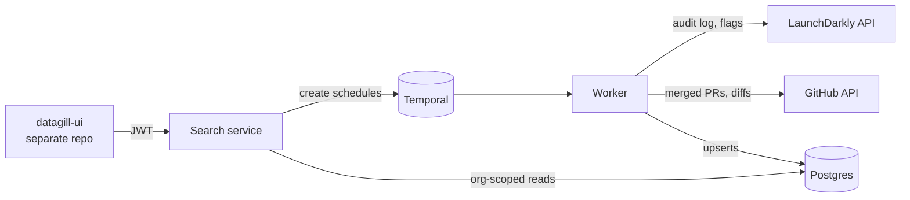

```
      /`·.¸
     /¸...¸`:·
 ¸.·´  ¸   `·.¸.·´)
: © ):´;      ¸  {
 `·.¸ `·  ¸.·´\`·¸)
     `\\´´\¸.·´

    d a t a g i l l
```

**Measure engineering impact by what ships, not by PR counts.**

> **Status:** early-stage side project. No production users yet. APIs, schema, and docs
> may change without notice.

---

## Why DataGill

Engineering is increasingly measured by what's easiest to count: pull requests, lines of
code, AI tokens spent. None of these tell you whether anything got better for customers.

The real story of what a team shipped is there, but it's scattered. Code lives in GitHub,
launches in a feature-flag platform, incidents in PagerDuty, tickets in Jira or Linear.
Each tool sees one slice, and none of them can say what happened, why, and what it changed.

DataGill connects those tools into **one timeline of engineering events that explains
itself and that you can query**:

- **Every change, understood.** Each code change is classified (bug fix, feature,
  improvement), summarized in plain language, and mapped to its project.
- **Every event, connected.** A PR links to the flag that launched it, the incident it
  caused or fixed, and the ticket that asked for it.
- **Every question, answerable.** *"What was our biggest win last quarter, and which team
  owned it?"* *"Which teams need more help shipping impactful work?"*

We're starting with feature flags and code, because a flag going live in production is the
clearest signal that work reached users.

## What works today

| Area | What it does |
|------|--------------|
| **LaunchDarkly** | Ingests the audit log and flag details every 30 minutes |
| **GitHub** | Ingests merged PRs through a GitHub App |
| **PR → flag links** | Scans each PR diff and records which flag keys it added or removed |
| **Timeline** | Feed of flag changes (who, what, when, which environment), filterable by team and person. PRs are a separate feed for now. |
| **Analytics** | Launched flags, top teams by activity, and time-to-rollout (org-wide only, rough) |
| **Platform** | Multi-tenant (all data scoped per org). Retry-safe Temporal workflows that keep every raw API response. |

## Architecture

Two Go binaries share one Postgres database and one Temporal cluster:

| Component | Path | Role |
|-----------|------|------|
| **Search service** | `services/search` | HTTP API (Chi) on `:8082`. Verifies JWTs, manages integrations, creates Temporal schedules, serves analytics. Holds no sync logic. |
| **Worker** | `cmd/worker` | Runs every Temporal workflow and activity: extract, normalize, save, enrich. |
| **App Postgres** | `db/migrations` | Raw `source_records` plus the canonical tables. |
| **Temporal** | `docker-compose.yml` | Schedules, durable execution, retries. Has its own Postgres. |



**How data flows: ingestion → enrichment → timeline**

1. **Schedule.** When an integration is connected, the search service creates a Temporal
   schedule (`etl-<integration>`, every 30 min) that starts `FeatureFlagETLWorkflow`.
   The workflow exits without doing anything if the integration is paused or deleted.
   Otherwise it routes to the provider's extract workflow.
2. **Ingest.** `LaunchDarklyExtractWorkflow` and `GitHubExtractWorkflow` page through the
   provider API from `integrations.last_synced_at`. They save each raw response to the
   append-only `source_records` table, then normalize and upsert into the canonical tables:
   `feature_flags`, `feature_flag_changelog` and `pull_requests`. The cursor moves forward
   only after the whole window is saved.
3. **Enrich.** Saving a PR also queues a `pull_request_enrichments` row in the same
   transaction. A per-org `GitHubEnrichmentWorkflow` claims pending rows, fetches each
   diff, and records the flag keys the PR added or removed. Failures back off across runs,
   from 30 minutes up to 24 hours.
4. **Serve.** The UI calls `GET /v1/analytics?metric=...`. Each metric is a small plugin
   that runs an org-scoped SQL query over the canonical tables.

More detail on design decisions and trade-offs is in [`docs/architecture.md`](./docs/architecture.md).

## Roadmap

Not built yet:

| Area | Plan |
|------|------|
| **Understand changes** | Use an LLM to classify each change (bug fix, feature, improvement), summarize it, and map it to a project |
| **Unified timeline** | Merge flags, PRs and other sources into one stream; show the PRs behind each launch |
| **Query in plain language** | Semantic search over the timeline (pgvector, embeddings behind an `EmbedProvider` interface) |
| **More sources** | PostHog, Statsig, Unleash, Flagsmith, PagerDuty, Datadog, Jira, Linear |
| **Flag insights** | Human vs. automated changes, rollbacks, stale flags, per-team velocity |
| **Privacy** | See below |

**Privacy model (planned).** Today the API shows who changed or launched a flag to every
member of the org. The plan:

- Leaders see team-level aggregates only, and only for teams above a minimum size.
- Each person sees their own data.
- Individual data is shared only by that person's choice, for example for a promotion
  document.

## Local development

### Prerequisites

| Tool | Version |
|------|---------|
| Go | 1.26 (see `go.work`) |
| Docker with Compose v2 | recent |
| [golang-migrate](https://github.com/golang-migrate/migrate) | 4.x (`brew install golang-migrate`) |
| [golangci-lint](https://golangci-lint.run/) | v1.64.8, only needed for `make lint` |

The web UI lives in a **separate repository**, `datagill-ui`. The commands below assume it
is checked out next to this one as `../datagill-ui`. The search service fetches signing keys
(JWKS) from the UI's auth server on startup and **exits if it can't reach them**. Start
`datagill-ui` first if you want the API to stay up. The worker, databases, and Temporal run
without it.

### Quick start

```bash
cp .env.example .env
# Set ENCRYPTION_KEY in .env (required):
openssl rand -hex 32

make docker-up                        # Postgres, Temporal, observability, search, worker
set -a && source .env && set +a
make migrate                          # apply db/migrations to app-postgres

curl http://localhost:8082/healthz    # {"service":"search","status":"ok"} once datagill-ui is up
```

| Service | URL |
|---------|-----|
| Search API | http://localhost:8082 |
| Temporal UI | http://localhost:8080 |
| Grafana | http://localhost:3000 (admin / admin) |
| Prometheus | http://localhost:9090 |
| DataGill UI (from `datagill-ui`) | http://localhost:3001 |

GitHub ingestion requires your own GitHub App. The `GITHUB_APP_*` variables are described
in [`LOCALSETUP.md`](./LOCALSETUP.md), along with running the services with `go run` and
troubleshooting.

### Tests, lint, build

```bash
make test-unit   # unit tests, no external dependencies
make test-int    # integration tests; needs Docker (testcontainers)
make lint        # golangci-lint across all modules
make build       # builds bin/worker and bin/search
make vuln        # govulncheck, per module
```

### Seeding demo data

After you sign up in the UI and connect an integration, you can fill the dashboard with demo
flags and changelog events:

```bash
# Find your org and integration keys
psql "$APP_DATABASE_URL" -c "SELECT key, external_org_id FROM organizations;"
psql "$APP_DATABASE_URL" -c "SELECT key, org_id, source FROM integrations;"

go run ./cmd/seed \
  --db-url "$APP_DATABASE_URL" \
  --org-id "<organizations.key>" \
  --integration-id "<integrations.key>"
```

The seed script is idempotent, so it's safe to run more than once.

## Repository layout

```
cmd/worker/         Worker binary: registers workflows, activities, error interceptor
cmd/seed/           Demo data seeder
services/search/    HTTP API: auth, integrations, scheduler, analytics plugins
workflows/          Temporal workflows (ETL router, launchdarkly/, github/)
activities/         Temporal activities: provider clients, normalization, diff scanning
models/             Canonical models and deterministic key functions
repository/         Postgres access (pgx), encryption, upserts
shared/             Cross-module error types
db/migrations/      Forward-only SQL migrations
infra/              Prometheus, Loki, Alloy, Grafana config
docs/               Architecture, product, engineering standards, API reference
```

Each directory is its own Go module in a single `go.work` workspace.

## Documentation

- [`docs/architecture.md`](./docs/architecture.md): how the system works and why, the data model, and decision history.
- [`docs/product.md`](./docs/product.md): requirements, roadmap and open questions.
- [`AGENTS.md`](./AGENTS.md): the rules for contributors and coding agents, with [`docs/engineering-standards.md`](./docs/engineering-standards.md) for the details.
- [`LOCALSETUP.md`](./LOCALSETUP.md): full local setup, including GitHub App configuration.

## Contributing and security

See [`CONTRIBUTING.md`](./CONTRIBUTING.md). To report a vulnerability, see
[`SECURITY.md`](./SECURITY.md). Please don't open a public issue.

## License

[Apache License 2.0](./LICENSE). We may move future versions to a different license as the
project grows. Code already released under Apache-2.0 stays available under it.
