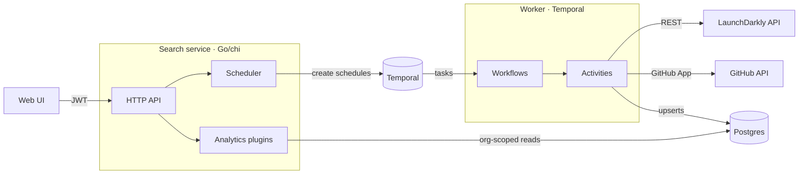
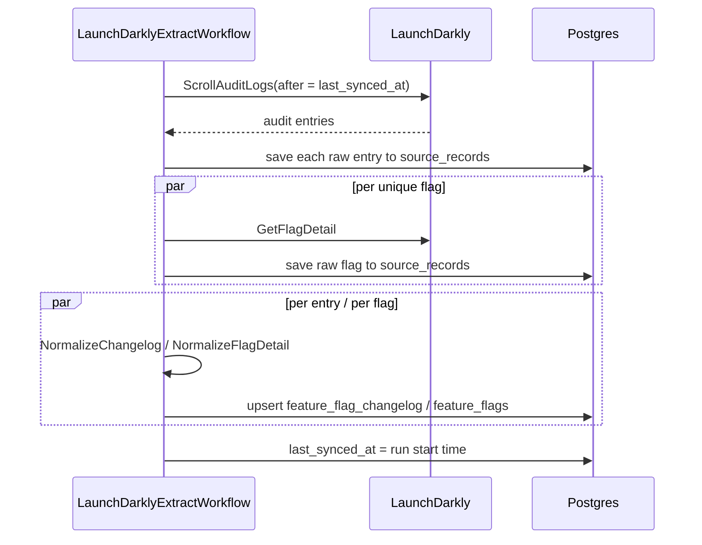
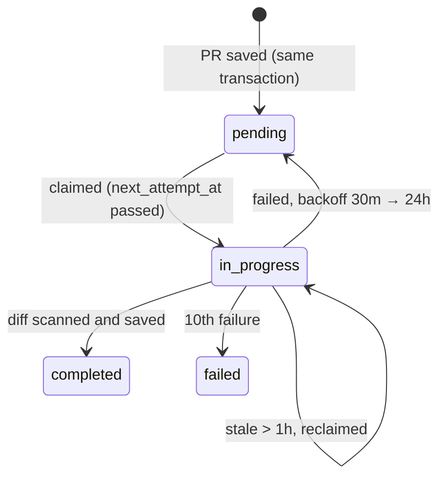

# Architecture

DataGill pulls change data from the tools a software team uses (feature flags from
LaunchDarkly, merged pull requests from GitHub), normalizes it into one Postgres model, and
serves analytics over it: what changed, who changed it, how fast flags ship, and which PRs
added or removed which flags.

This document explains how the backend is built and, more importantly, **why**. Each design
decision lists the trade-off it accepts.

- [System overview](#system-overview)
- [Tech stack](#tech-stack)
- [Pipelines](#pipelines)
- [Design decisions](#design-decisions)
- [Failure handling](#failure-handling)
- [Security and multi-tenancy](#security-and-multi-tenancy)
- [Observability](#observability)
- [Testing](#testing)
- [Known limitations](#known-limitations)
- [Data model](#data-model)
- [Repository map](#repository-map)
- [Decision history](#decision-history)

---

## System overview



There are two binaries:

| Component | Role |
|-----------|------|
| **Search service** (`services/search`) | HTTP API for the UI. Manages integrations, creates Temporal schedules when one connects, and serves analytics. Holds no sync logic. |
| **Worker** (`cmd/worker`) | Runs every Temporal workflow and activity: extracting from providers, normalizing, saving, and enriching. |

They share only Postgres and Temporal. The API stays fast and stateless, and the worker can
be scaled, restarted, or redeployed mid-sync without losing work.

---

## Tech stack

### Decided

| Layer | Choice | Rationale |
|-------|--------|-----------|
| Frontend | Next.js (App Router) + shadcn/ui | Best-in-class SSR; accessible components we own |
| Go DB access | pgx (`pgxpool`) with hand-written SQL | In use |
| Backend | Go + Chi | Goroutines fit ETL concurrency; Chi is lightweight and stdlib-compatible |
| Database | PostgreSQL 16 + pgvector | ACID, JSONB, vector search. Two instances: one for Temporal state, one for app data |
| Auth | BetterAuth (in `datagill-ui`) | In use. The search service verifies BetterAuth-issued JWTs against its JWKS |
| Embeddings | OpenAI text-embedding-3-small / Ollama nomic-embed-text | Post-MVP. Swappable via EmbedProvider interface |
| Orchestration | Self-hosted Temporal | Replaces queues. Durable state, retry, scheduling in one primitive |
| Migrations | golang-migrate | Run as a separate step (`make migrate`) |
| Metrics | Prometheus + Grafana | Scrape endpoint at /metrics on all services |
| Secrets | AWS Secrets Manager (cloud) / env vars + Docker secrets (self-hosted) | |
| Provider auth | API key (MVP) | Customer pastes read-only key; encrypted at rest with AES-256-GCM |
| Webhooks | None in v1 — poll only | No inbound public endpoints; customers provide API key |

### Still open

Also listed in [product.md](./product.md#open-questions).

| Decision | Options | Blocking On |
|----------|---------|-------------|
| Hosting / compute | Railway, Fly.io, GCP Cloud Run, VPS | Cost analysis |
| Frontend data fetching | TanStack Query, SWR, RSC-only | LLD session |
| Provider auth V2 | OAuth (no manual key management) | Post-MVP |

---

## Pipelines

Every pipeline follows the same three steps: **extract → save raw → normalize and upsert.**

### Scheduling

When an integration connects, the search service creates a Temporal schedule with a fixed
ID (`etl-<integration key>`). It runs every 30 minutes, with `SKIP` overlap so a slow sync is
never doubled up. Creating it is idempotent, so retrying a failed connect is safe.

Each run starts `FeatureFlagETLWorkflow`. It loads the integration and **exits quietly if the
integration is paused or deleted**, so schedules never need to be torn down in step with the
database. If the integration is active, it routes to the provider's extract workflow.

### LaunchDarkly



Normalization turns LaunchDarkly's audit format into a canonical changelog event: event
type (created, updated, toggled, deleted), actor, and affected environments.

### GitHub pull requests

`GitHubExtractWorkflow` uses a GitHub App with short-lived installation tokens and ingests
merged PRs:

1. **Pick a time window.** It starts at `last_synced_at` minus a 5-minute overlap, because
   GitHub's search index lags. A first sync goes back 30 days. One run covers at most
   24 hours.
2. **Search, splitting when needed.** GitHub search returns at most 1,000 results per query.
   If a window reports more than 900, or flags incomplete results, the workflow splits the
   window in half and recurses. It stops splitting at 5 minutes.
3. **Fetch details** in parallel batches of 10, save each raw response, normalize, and upsert.
4. **Advance the cursor** (`last_synced_at`) only after every PR in the window is saved.
5. **Catch up with Continue-As-New:** if the window ended before "now", the next 24-hour chunk
   starts in a fresh run with a clean history.

#### GitHub App and onboarding

DataGill uses one GitHub App. A customer connects GitHub by installing it on an organization
or personal account; each installation is one `github` integration row. The app is read-only:
repository `Metadata: read` and `Pull requests: read`.

- **Why a GitHub App, not an OAuth app:** fine-grained, installation-scoped permissions and
  short-lived installation tokens, with no long-lived user tokens to store.
- **Why the callback URL, not the setup URL:** GitHub warns that the `installation_id` sent to
  a setup URL can be spoofed. Instead, `POST /v1/auth/github` returns an install URL with a
  signed, short-lived `state` and `request_oauth_on_install=true`. The callback
  (`GET /v1/auth/github`) verifies the `state`, exchanges the one-time `code` for a user token,
  checks that this user can actually see the installation, then discards the user token and
  creates the integration and its schedules.
- **Secrets stay out of the database.** The app ID, private key and client secret come from env
  vars. `integrations.config` stores only installation metadata (`installation_id`,
  `account_login`, `account_type`, `repository_selection`). Installation tokens are minted inside
  activities, so they never land in Postgres or in Temporal workflow history.
- **Discovery uses the Search API.** GitHub has no endpoint that lists PRs across every repo in
  an installation, and enumerating repos first costs one call per repo. `GET /search/issues`
  finds merged PRs owner-wide, then each PR's detail is fetched (10 at a time). Search caps
  results at 1,000 per query, which is why windows split (see above).

### PR enrichment

Each saved PR also gets an enrichment row. `GitHubEnrichmentWorkflow` runs on a per-org
schedule and scans each PR's diff for known flag keys, recording which flags it **added** and
which it **removed**. This is how DataGill links "flag created" to "code shipped".

The scan follows the approach of LaunchDarkly's
[`find-code-references-in-pull-request`](https://github.com/launchdarkly/find-code-references-in-pull-request)
action (`activities/github/scan_diff.go`):

- **Flag keys** are the org's current keys from `feature_flags` (`data.source.key`), loaded
  when the PR is enriched.
- **Diff fetch:** the PR's unified diff. If GitHub answers 406 (diff too large), the worker
  rebuilds it from the compare API, since it has no local git checkout.
- **Files skipped:** dotfiles, and files whose path changed (renames).
- **Matching:** plain substring match of each flag key on `+` and `-` lines. A key on any `+`
  line counts as **added**; a key only on `-` lines counts as **removed**.



---

## Design decisions

### 1. Temporal for orchestration

**Why:** Syncing third-party APIs is mostly failure handling: rate limits, timeouts, worker
restarts, partial pages. Temporal gives durable execution, per-step retries, schedules, and
a visible history of every run. Without it, all of that would be a hand-built job queue.

**Trade-off:** It is one more service to operate. Workflow code must also be deterministic
(`workflow.Now`, `workflow.Go`, no direct I/O), which is a learning curve for contributors.

### 2. Save raw data before transforming it

Every raw API response goes into `source_records` before any normalization. The table is
append-only, and each normalized row keeps a `source_record_key` back to its raw source.

**Why:** Normalization is where bugs live. With the raw payloads stored, a mapping fix can be
replayed over history **without calling the provider again**. That matters when providers
rate-limit or only keep audit logs for a limited time.

**Trade-off:** It uses more storage, since every payload is kept twice: raw and normalized.

### 3. Deterministic keys + idempotent upserts

Every row's key is a UUID v5 derived from its natural identity
(`models/keys.go`), for example `org_id | source | project | flag_key`. All writes are
`INSERT ... ON CONFLICT`: upserts for canonical tables, `DO NOTHING` for raw records.

**Why:** Any step can be retried or replayed any number of times without creating duplicates.
Extract and normalize can each compute the same key independently, with no lookups or
coordination. `org_id` is part of every key, so two tenants with identical project and flag
names can never collide.

**Trade-off:** The key format is permanent. Changing the namespace or the key inputs means
rewriting every row.

### 4. Move the sync cursor only after success

Both pipelines store their position in `integrations.last_synced_at`, and only update it
after the whole window is saved.

**Why:** If a run fails halfway, the next run repeats the same window instead of skipping it.
Repeated work is harmless (see #3). Gaps would not be.

**Trade-off:** A run that keeps failing keeps redoing the same window. Upserts make that safe,
but not free.

### 5. Bounded workflow history

GitHub syncs process at most 24 hours per run and continue in a fresh run via
Continue-As-New.

**Why:** Temporal history grows with every activity. A 30-day backfill in one run would create
a very large history and slow replays. Chunking keeps each run small, and a crash costs at
most one chunk.

### 6. Make retry intent explicit

Temporal only reads retry settings from the outermost error an activity returns, and retries
everything else forever. Wrapping errors with `fmt.Errorf` therefore silently drops a "do not
retry" flag. A worker interceptor (`activities/error_classification.go`) classifies every
activity error:

| Error | Behaviour |
|-------|-----------|
| 401 bad credentials, missing installation | Non-retryable: fail fast, don't hammer the API |
| 403/429 rate limit | Retryable, next attempt waits for the provider's `Retry-After` (GitHub and LaunchDarkly) |
| 404 on a single PR (deleted repo or PR) | Skipped; the rest of the run continues |
| Anything else | Retryable with the default policy |

**Why:** Activities can return ordinary wrapped Go errors, and retry behaviour is decided in
one place and covered by tests.

### 7. Postgres as the work queue for enrichment

Enrichment status lives in `pull_request_enrichments`, not in a long-running workflow:

- The row is inserted **in the same transaction** as its PR, so no PR can be missed.
- A worker **claims** a row with a conditional `UPDATE` and only proceeds if it updated
  exactly one row. Concurrent runs can't process the same PR.
- A claim older than 1 hour counts as abandoned (for example, the worker died) and can be
  claimed again.
- Results are saved only if the row is still `in_progress`, so a stale run can't overwrite a
  finished one.
- Failures back off exponentially **across runs**: 30 minutes, doubling, capped at 24 hours.
  After 10 failures (about 4 days) the row is marked `failed`.

**Why not Temporal retries alone?** Temporal retries cover seconds to minutes inside one run.
A multi-day GitHub outage needs retries over days, without one stuck PR blocking a batch.
Inside a run, activities get 3 attempts and a bounded time budget; anything beyond that falls
back to the database schedule.

**Trade-off:** The retry logic is split between Temporal (short term) and SQL (long term).
The split is documented in `workflows/github/enrichment.go`.

### 8. Canonical JSONB data with typed Go models

Canonical tables keep their shared, queryable columns (`org_id`, `integration_id`, `state`,
timestamps) as real columns. Provider-specific details go into a `data` JSONB column, which is
backed by typed Go structs. Queries rely on B-tree and expression indexes on the typed
columns; the only GIN indexes are on PR enrichment flag arrays (see [Data model](#data-model)).

**Why:** Each provider has a different shape. JSONB lets a new provider land without a
migration per field, while the columns and indexes that analytics depend on stay strict.

**Trade-off:** The database can't enforce schema rules inside `data`, so the Go models and
tests have to.

### 9. Analytics as plugins

Each metric (`launched_wins`, `velocity`, `top_teams`, `audit_log`, `pull_requests`)
implements a small interface and registers itself in a registry. One endpoint,
`GET /v1/analytics?metric=...`, routes to it. The handler parses the org, date range and
limits before any plugin runs.

**Why:** Adding a metric means adding one file, with no routing or handler changes. Every
metric receives an org-scoped query, so none can skip tenant filtering.

### 10. Adding a provider never touches existing ones

Extract and normalize code is per provider. Saving, keys, canonical models, and the
repository layer are shared. The top-level workflow routes on `integration.source`.

---

## Failure handling

| What happens | Result |
|--------------|--------|
| Worker crashes mid-sync | Temporal resumes the workflow on another worker from its last completed step. |
| Sync fails halfway | Cursor not advanced; the next run repeats the window. Upserts absorb duplicates. |
| GitHub or LaunchDarkly rate limit | Activity waits for `Retry-After`. Enrichment gives up after a 5-minute budget and backs off across runs. |
| Credentials revoked | Non-retryable error; the run fails immediately instead of retrying forever. |
| PR or repo deleted after search | That PR is skipped; the rest of the run continues. |
| Integration paused or deleted | Next scheduled run exits without calling the provider. |
| Two syncs overlap | Schedule `SKIP` policy plus fixed workflow IDs; a duplicate start is ignored. |
| Enrichment worker dies mid-claim | Claim goes stale after 1 hour and is picked up again. |
| Normalization bug shipped | Fix it and re-run transforms from `source_records`. No provider calls needed. |

---

## Security and multi-tenancy

- **Tenant isolation:** every repository query filters by `org_id`, and the org comes only from
  the verified JWT, never from request parameters. `org_id` is part of every deterministic key.
- **Authentication:** the API verifies RSA-signed JWTs against the auth provider's JWKS,
  rejects any other signing algorithm, and requires an expiry. Only `/healthz`, `/metrics` and the GitHub install callback are public.
- **Provider credentials:** API keys are encrypted at rest with AES-256-GCM
  (`repository/crypto.go`). GitHub uses App installation tokens that expire after an hour, so
  no long-lived user tokens are stored.
- **Supply chain:** CI runs `govulncheck` on every module for every pull request and push to `main`.

---

## Observability

The local stack (`docker-compose.yml`) runs the full monitoring setup:

- **Metrics:** Prometheus scrapes the search service (request rate, latency, status codes),
  with provisioned Grafana dashboards. A `worker` scrape target and dashboard are configured,
  but the worker does not expose a metrics endpoint yet.
- **Logs:** the search service writes structured JSON logs (zerolog) with `request_id`,
  `org_id` and `user_id` attached per request. The worker still logs plain text (Go's `log`
  and Temporal's default logger). Logs are shipped to Loki through Grafana Alloy.
- **Workflows:** the Temporal UI shows every sync run, activity, retry, and failure.

---

## Testing

| Layer | Approach |
|-------|----------|
| Workflows | Temporal's test environment with mocked activities: splitting, Continue-As-New, skip-on-404, retry budgets |
| Activities and API clients | `httptest` servers that replay provider responses and error codes |
| Repository | Integration tests against real Postgres 16 via testcontainers (`-tags=integration`) |
| HTTP handlers | Table-driven tests through the real router and middleware |

There are about 7.9k lines of tests for 7.7k lines of production code.

```bash
make test-unit   # no dependencies
make test-int    # needs Docker
```

---

## Known limitations

- **One sync interval for every integration.** Schedules use a fixed 30-minute interval;
  per-integration intervals aren't exposed yet.
- **LaunchDarkly skips rows with non-retryable errors.** A normalize or save step that fails
  permanently is logged and skipped, and the cursor still advances. The raw entry is in
  `source_records`, so it can be replayed, but nothing replays it automatically yet.
- **One Postgres for writes and analytics.** That's fine at this scale. Heavy analytics would
  move to a read replica or a column store.
- **No retroactive flag links.** Keys are matched against the flags known when the PR is
  enriched. A flag created later is not linked to older PRs; re-enriching means resetting
  rows to `pending` by hand (there is also no API to retry a `failed` row).
- **Renamed files are not scanned,** including renames that also change content.
- **Diff scanning is plain text matching.** A flag key that appears in a comment or string
  counts as a reference. This is the same approach LaunchDarkly's own code-references action
  uses.
- **Migrations are forward-only.**
- **Worker observability is thin.** No worker metrics endpoint and no structured worker logs
  yet (see [Observability](#observability)).
- **Velocity is measured from ingestion.** The `velocity` metric uses `feature_flags.created_at`,
  which is when DataGill first stored the flag, not when it was created in LaunchDarkly.

---

## Data model

Two PostgreSQL 16 instances: `temporal-postgres` (Temporal's own state; do not touch) and
`app-postgres` (everything below). The migrations in `db/migrations/` are the source of truth
for columns and indexes; this section explains the conventions behind them.

| Table | Holds |
|-------|-------|
| `organizations` | One row per tenant. `external_org_id` maps to the auth provider's org, so swapping providers touches one column |
| `integrations` | One row per provider connection: encrypted API key, provider `config` (JSONB), `state`, `last_synced_at` cursor |
| `source_records` | Append-only raw API responses. Never updated |
| `feature_flags` | Current normalized state per flag |
| `feature_flag_changelog` | One row per flag change event, with the source's `occurred_at` |
| `pull_requests` | Normalized merged PRs |
| `pull_request_enrichments` | Per-PR enrichment status, retry schedule, and flag keys added/removed |

**Conventions**

- `id` (bigserial) is the internal primary key; `key` (UUID, unique) is a deterministic UUID v5
  used for every cross-table reference.
- `org_id` and `integration_id` hold the `key` of their rows, with FKs and `ON DELETE CASCADE`.
  References between data tables (`source_record_key`, `feature_flag_key`) have no FK, so
  extract and transform can compute them independently.
- Typed columns for anything filtered, sorted or joined (`org_id`, `state`, `occurred_at`);
  normalized payloads go in `data` (JSONB). Promote a JSONB field to a column only when a query
  needs it.
- Enums are stored as `text`; timestamps are always `timestamptz`.
- `occurred_at` is always the source system's time, never ingestion time.

**Deterministic keys** (`models/keys.go`): `ComputeFlagKey`, `ComputeChangelogKey`,
`ComputeSourceRecordKey` and `ComputePullRequestKey` hash the org ID plus the entity's natural
identity (for example `org_id | source | project | flag_key`). Environment is not part of a flag's
key: all environments live in the same row under `data.environments`.

**JSONB shapes** are defined by the Go structs in `models/canonical.go`,
`models/pull_request.go` and `models/pull_request_enrichment.go`. Readers ignore unknown fields,
so add fields freely; never silently rename or remove one.

**Indexing:** B-tree indexes on `org_id`, `integration_id` and `(org_id, occurred_at)`, plus an
expression index on `feature_flags(org_id, data->'source'->>'key')`. GIN indexes exist only on
`pull_request_enrichments` flag arrays. Add a JSONB GIN index only when `EXPLAIN ANALYZE` shows
a query needs it. pgvector is available in the `app-postgres` image but not enabled by any
migration yet.

---

## Repository map

```
cmd/worker/         Worker binary: registers workflows, activities, interceptor
cmd/seed/           Demo data seeder
services/search/    HTTP API, auth, scheduler, analytics plugins
workflows/          Temporal workflows (ETL router, launchdarkly/, github/)
activities/         Temporal activities: provider clients, normalization, error classification
models/             Canonical models and deterministic key functions
repository/         Postgres access (pgx), encryption, upserts
shared/             Cross-module error types
db/migrations/      Forward-only SQL migrations
infra/              Prometheus, Loki, Alloy, Grafana config
docs/               Architecture, product, engineering standards, design notes
```

Each directory is its own Go module in one `go.work` workspace. The search service doesn't
depend on the worker's workflow code; it starts workflows by name through Temporal.

---

## Decision history

Architecture changes recorded in AGENTS.md before it was split (2026-11). Newer decisions go here.

### v1.2 — 2026-11-13

- Docs synced with the code ahead of open-sourcing: GitHub ingestion + PR enrichment marked as implemented; workflow hierarchy, schedule settings, endpoints, security model (JWT/JWKS, not `X-Org-Id`), table list, FK statement, migrations and repo structure updated. No architecture decisions changed.

### v1.1 — 2026-11-01

- Sync cursor moved from Temporal workflow state to `integrations.last_synced_at`, for all providers. Since each scheduled run became a separate workflow (one run per schedule), workflow state no longer carried between runs, and the GitHub ETL only searched a fixed 35-minute window. Runs now resume from the last successful position and update it only on success.
- Schedules stay in place when an integration is paused or deleted; each run checks the integration state instead.

### v1.0 — 2026-03-18

- Replaced generic workflow hierarchy with provider-specific extract/transform workflows: `LaunchDarklyExtractWorkflow`, `LaunchDarklyChangelogTransformWorkflow`, `LaunchDarklyFeatureFlagTransformWorkflow`
- Added `FeatureFlagETLWorkflow` as scheduled entry point that routes by `integration.source`
- Schema redesign — five tables: `organizations`, `integrations`, `source_records`, `feature_flags`, `feature_flag_changelog`
- Added `source_records` table: append-only raw data store, written by Extract before transformation. Replaces inline `source_data` column on canonical tables
- Canonical tables (`feature_flags`, `feature_flag_changelog`) now use `data jsonb` for normalized structured data, with `source_record_key` reference back to raw data
- Dropped `raw_events` and `normalized_events` tables from previous design
- Promoted `feature_flags` table from open question (P1) to MVP
- Renamed `audit_log` → `changelog` throughout
- New key convention: `id` (bigserial PK) + `key` (deterministic UUID v5) on all tables. No FK constraints — cross-table correlation via shared deterministic keys
- Defined normalized data model for `feature_flags.data`: `name`, `description`, `source`, `maintainer`, `lifecycle`, `environments`
- `lifecycle.purpose` (`temporary | permanent`) and `lifecycle.state` (`active | stale | dead | archived | deprecated`)
- `state` column on tables represents operational state; `lifecycle.state` in data represents health state
- All provider config fields moved to `integrations.config jsonb`
- Auth provider indirection via `organizations.external_org_id` — swap Clerk/BetterAuth by updating one column
- Added fire-and-forget with ack pattern: `GetChildWorkflowExecution().Get()` + `ParentClosePolicy: ABANDON`
- Extract saves raw data to `source_records` before fanning out transforms
- JSONB indexing strategy: start with no GIN indexes, add per-path when needed
- Updated repo structure to reflect provider-specific code organization
- Added post-MVP enrich workflows: `FeatureFlagEnrichWorkflow` (fire-and-forget), `FeatureFlagAnalysisWorkflow` (scheduled daily)

### v0.8 — 2026-03-17

- Renamed workflows to ETL pattern: `FeatureFlagExtractWorkflow`, `FeatureFlagTransformWorkflow`, `NormalizeWorkflow`
- Deferred embeddings and `event_embeddings` table to post-MVP
- Added `source_type` to integrations for workflow dispatch
- Generalized `normalized_events`: `flag_key` → `entity_key`, `flag_name` → `entity_name`, dropped `flag_kind`, `flag_data`, `raw_event`; added metadata/column boundary rule
- Removed `FetchFlagStates` activity (was only feeding `flag_data`)
- Removed `flag_keys` from `raw_events`
- Added `created_at`/`updated_at` to all tables
- Collapsed migrations to single `001_initialize.sql`
- Moved flag detail page into MVP scope
- Updated `feature_flags` open question with P1 direction (derive at MVP, materialize at P1)

### v0.7 — 2026-03-17

- Dropped `flag_cache` table (in-memory dedup within a batch is sufficient)
- Merged `enriched_events` into `normalized_events`
- Thinned `organizations` table (Clerk owns name, billing, membership)
- Added reasoning inline for each schema decision

### v0.6 — 2026-03-13

- Replaced BullMQ + Redis with self-hosted Temporal throughout
- Added `integrations` table; cursor moved to Temporal durable workflow state
- Removed `poll_locks` and `integration_cursors` tables
- Added product requirements section (MVP, P0, P1, P2)
