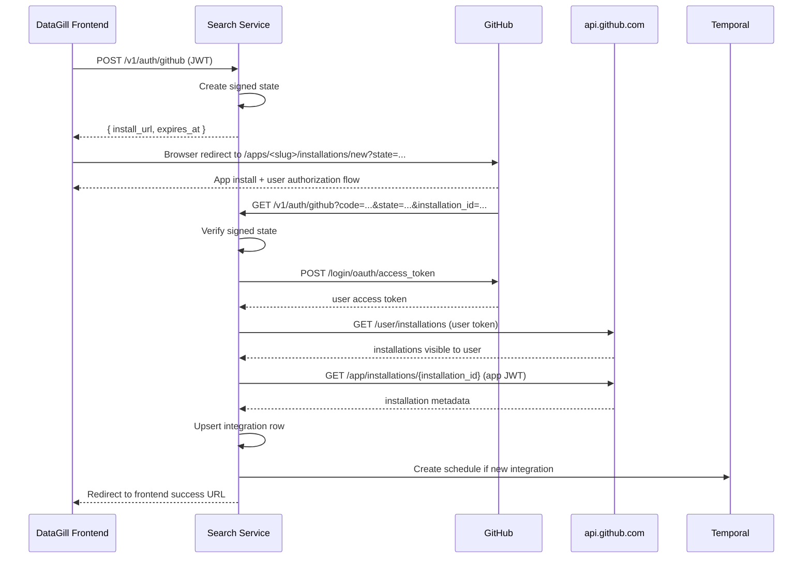

# GitHub Integration Implementation Plan

> Status: Implemented. Kept as the design record for the GitHub integration.
> **Historical design doc.** Written while building; parts are out of date. The code and [`AGENTS.md`](../../AGENTS.md) are the source of truth where they disagree.
> Companion to [github-integration.md](./github-integration.md).

This document translates the approved GitHub integration design into concrete repo work. It is intentionally scoped to the current codebase, which already has LaunchDarkly ETL, integration management endpoints in the Search service, and Temporal schedule wiring.

## Critical Architecture Decision

The original onboarding idea used the GitHub App setup URL. That is not the right v1 implementation.

- GitHub's docs warn that the `installation_id` sent to a setup URL is spoofable and should not be trusted by itself.
- GitHub also documents that if `request_oauth_on_install=true`, the setup URL is unavailable and users are redirected to the app's callback URL after installation.
- Therefore, DataGill v1 should use the GitHub App callback URL plus one-time user authorization during installation.
- This does not change the ETL auth model. ETL still uses installation access tokens only.
- The user access token exists only during onboarding so Search can verify that the installing user can actually access the installation being connected.

## Spike Outcome — 2026-04-24

The onboarding spike answered the two main open questions from this plan.

Confirmed with a real installation:

- GitHub's combined install + authorize callback returns:
  - `code`
  - `installation_id`
  - `setup_action`
  - `state`
- Search can exchange `code` for a GitHub App user access token.
- Search can verify installation visibility via `GET /user/installations`.
- Search can fetch authoritative installation metadata via app JWT auth.
- Search can mint an installation access token.
- `GET /search/issues` works with installation auth using only:
  - repository `Metadata: read`
  - repository `Pull requests: read`

Resolved decisions:

- callback parsing in Slice 2 can treat `installation_id` as present in the `request_oauth_on_install=true` flow
- no broader read permission is required for v1 discovery at this time
- the onboarding/search spike goals are complete; future work should move back to clean implementation branches

## Goals

V1 goal:

- connect a GitHub App installation from the Search service
- persist installation-scoped GitHub integrations
- schedule GitHub ETL like existing integrations
- ingest merged pull requests into raw + canonical storage
- keep scope to base PR ingestion only

Explicitly out of scope for V1:

- completed reviewers
- co-authors
- review summary
- permission drift automation
- webhook ingestion
- diff content ingestion

## Current Codebase Constraints

The current repo is not GitHub-ready yet. These are the main constraints the implementation plan must absorb:

- `models.Source` only supports LaunchDarkly, Unleash, and Flagsmith.
- `models.IntegrationConfig` is LaunchDarkly-shaped (`environment_key`) and cannot yet represent GitHub App installation metadata cleanly.
- Search integration creation assumes API-key validation before insert.
- Temporal schedule management only supports create. This is acceptable for v1 as long as ETL exits immediately for non-active integrations.
- ETL routing in [workflows/etl.go](../../workflows/etl.go) only dispatches LaunchDarkly.
- Repository and canonical models have no `pull_requests` persistence surface yet.
- Live code still has `integrations.last_synced_at`, which conflicts with the current architecture decision that sync cursor belongs in Temporal workflow state.

## Model and Config Changes

These changes matter before implementation starts. Future agents should not invent alternative shapes.

### Search Config

Add these env vars to Search:

- `GITHUB_APP_ID`
- `GITHUB_APP_CLIENT_ID`
- `GITHUB_APP_CLIENT_SECRET`
- `GITHUB_APP_PRIVATE_KEY_B64`
- `GITHUB_APP_SLUG`
- `GITHUB_APP_CALLBACK_URL`
- `GITHUB_APP_STATE_SECRET`
- `FRONTEND_URL`

Notes:

- Use `GITHUB_APP_PRIVATE_KEY_B64` as the single private-key format. Do not support both raw PEM and base64 in v1.
- `GITHUB_APP_CALLBACK_URL` must exactly match one configured callback URL in the GitHub App settings.
- `GITHUB_APP_STATE_SECRET` signs DataGill's short-lived onboarding state.

### GitHub App Permissions

V1 app permissions should remain read-only.

Required repository permissions:

- `Metadata: read`
- `Pull requests: read`

Reasoning:

- `GET /repos/{owner}/{repo}/pulls/{pull_number}` accepts GitHub App installation tokens with `Pull requests: read` or `Contents: read`; prefer `Pull requests: read` because it is narrower.
- repository metadata is needed for repository identity and installation/repository surfaces.

Validated by spike:

- `GET /search/issues` works for v1 with `Metadata: read` plus `Pull requests: read`
- no extra repository permission is currently required

### Integration Model

Keep using `integrations.config` for provider-specific metadata.

GitHub config shape:

```json
{
  "installation_id": 12345678,
  "account_login": "acme-org",
  "account_type": "Organization",
  "repository_selection": "selected"
}
```

LaunchDarkly config remains backward-compatible with `environment_key`.

### DB Changes For Onboarding

No new columns are required for GitHub onboarding.

Required migration:

- add a partial unique index for GitHub integrations on installation identity

Recommended shape:

```sql
CREATE UNIQUE INDEX idx_integrations_github_installation
ON integrations (org_id, source, ((config->>'installation_id')))
WHERE source = 'github' AND state != 'deleted';
```

This is required because the current schema has no DB-level uniqueness enforcement for GitHub installations.

## Recommended Delivery Order

Implement in five slices. Each slice should land cleanly and keep `main` releasable.

### Slice 1: Integration and schedule plumbing

Goal: let Search create and manage a GitHub integration row without any ETL yet.

Files likely touched:

- [models/integration.go](../../models/integration.go)
- [services/search/handlers_integrations.go](../../services/search/handlers_integrations.go)
- [services/search/router.go](../../services/search/router.go)
- [services/search/config.go](../../services/search/config.go)
- [services/search/app.go](../../services/search/app.go)
- [services/search/scheduler.go](../../services/search/scheduler.go)
- [repository/postgres_integrations.go](../../repository/postgres_integrations.go)

Tasks:

1. Add `models.SourceGitHub`.
2. Expand `IntegrationConfig` to support GitHub installation metadata:
   - `installation_id`
   - `account_login`
   - `account_type`
   - `repository_selection`
   - keep `environment_key` optional for LaunchDarkly compatibility
3. Update integration duplicate logic:
   - LaunchDarkly stays one per provider per org for now, matching current API behavior
   - GitHub uniqueness should use installation identity, not provider-only duplicate checks
   - this temporary inconsistency is intentional and should be revisited only if integration uniqueness is redesigned across all providers
4. Add the GitHub installation unique index migration.
5. Ensure ETL exits immediately for integrations whose state is not `active`.

Notes:

- This slice should not yet perform GitHub App installation flow.
- It should only make the integration model GitHub-capable and enforce the disabled-integration no-op rule.

### Slice 2: GitHub App onboarding in Search

Goal: own the browser-based GitHub App install callback in the Search service.

Files likely touched:

- [services/search/router.go](../../services/search/router.go)
- [services/search/handlers_integrations.go](../../services/search/handlers_integrations.go)
- new `services/search/github_app.go`
- new `services/search/github_app_test.go`

Tasks:

1. Add Search config for GitHub App credentials and callback setup:
   - `GITHUB_APP_ID`
   - `GITHUB_APP_CLIENT_ID`
   - `GITHUB_APP_CLIENT_SECRET`
   - `GITHUB_APP_PRIVATE_KEY_B64`
   - `GITHUB_APP_SLUG`
   - `GITHUB_APP_CALLBACK_URL`
   - `GITHUB_APP_STATE_SECRET`
   - `FRONTEND_URL`
2. Add `POST /v1/auth/github` as the browser-start endpoint.
3. Add `GET /v1/auth/github` as the GitHub App callback handler owned by Search.
4. In the callback handler:
   - validate signed `state`
   - exchange `code` for a GitHub App user access token
   - verify the installation belongs to that user
   - fetch authoritative installation metadata
   - upsert the integration
   - create the Temporal schedule if this is a new integration
   - redirect back to the frontend
5. Make callback idempotent:
   - repeated callback for the same installation updates config and sets the integration `active`
   - callback must not create duplicate rows

This slice has one mandatory external API chain in Search:

1. `POST https://github.com/login/oauth/access_token`
   - exchange callback `code` for a GitHub App user access token
2. `GET /user/installations`
   - verify the callback installation appears in the set of installations visible to the authorized user
3. `GET /app/installations/{installation_id}`
   - fetch authoritative installation details using app JWT auth
4. optional `GET /installation/repositories`
   - only if Search needs to surface connected repository names immediately in UI; not required to persist the integration

Recommended endpoint contract:

- `POST /v1/auth/github`
  - JWT-protected
  - request body:
    ```json
    {
      "return_to": "/settings/integrations"
    }
    ```
  - response body:
    ```json
    {
      "install_url": "https://github.com/apps/<slug>/installations/new?state=<signed-state>",
      "expires_at": "2026-04-24T01:15:00Z"
    }
    ```
  - behavior:
    - verify JWT org/user context
    - mint short-lived signed `state`
    - build install URL using app slug and `state`
- `GET /v1/auth/github`
  - not protected by normal JWT middleware
  - expected query params:
    - required: `code`, `state`
    - optional/pass-through: `installation_id`, `setup_action`
  - behavior:
    - validate `state`
    - exchange `code` for a user access token
    - verify the installation is visible to that user
    - fetch authoritative installation metadata
    - upsert the integration
    - create/resume the schedule
    - redirect the browser back to the frontend settings page

### State Contract

Use a signed short-lived state token with this payload:

```json
{
  "org_id": "uuid",
  "user_id": "string",
  "nonce": "random",
  "return_to": "/settings/integrations",
  "issued_at": "2026-04-24T01:00:00Z",
  "expires_at": "2026-04-24T01:15:00Z"
}
```

Rules:

- TTL: 15 minutes
- signed with `GITHUB_APP_STATE_SECRET`
- if state is missing, invalid, or expired, abort onboarding
- best-effort replay protection is recommended, but TTL validation is the minimum v1 requirement

### Callback Verification Rules

Future agents should not improvise this logic.

1. Validate `state`.
2. Exchange `code` for a GitHub App user access token.
3. Read the optional `installation_id` query param if present, but do not trust it by itself.
4. Call `GET /user/installations` with the user token and verify the installation exists in that set.
5. Call `GET /app/installations/{installation_id}` with app JWT auth to fetch authoritative installation metadata.
6. Persist only installation metadata; discard the user token immediately after verification.

Do not persist user access or refresh tokens. If GitHub returns a refresh token as part of the user authorization flow, discard it after onboarding verification completes.

Fallback note:

- if GitHub ever stops providing `installation_id` on this callback in practice, Search would need to resolve the installation from the user's accessible installations during the onboarding window
- this fallback is not required for the currently validated flow

### Integration Upsert Rules

- lookup key: `(org_id, source='github', config.installation_id)`
- if existing row is `active`: update config in place, keep active
- if existing row is `paused`: update config and set state back to `active`
- if existing row is `deleted`: create a new row rather than mutating a deleted row
- if the same GitHub installation is somehow associated with a different DataGill org: still deferred; not needed to begin implementation

### Success and Error Redirects

Use deterministic frontend redirects:

- success:
  - `${FRONTEND_URL}/settings/integrations?provider=github&status=connected`
- callback validation failure:
  - `${FRONTEND_URL}/settings/integrations?provider=github&status=error&code=invalid_state`
- GitHub exchange or verification failure:
  - `${FRONTEND_URL}/settings/integrations?provider=github&status=error&code=github_auth_failed`
- persistence or schedule failure:
  - `${FRONTEND_URL}/settings/integrations?provider=github&status=error&code=integration_create_failed`

### Sequence Diagram



Recommendation:

- keep the callback server-side only
- do not persist GitHub installation access tokens in Postgres
- do not route callback logic through the worker
- use signed `state` as the callback trust boundary
- use one-time user authorization during install for installation verification, then discard the user token

### Slice 3: Schema and model groundwork for pull requests

Goal: create the storage surface before implementing ETL.

Files likely touched:

- new migration for `pull_requests`
- [models/canonical.go](../../models/canonical.go) or new `models/github.go`
- [repository/repository.go](../../repository/repository.go)
- new `repository/postgres_pull_requests.go`
- new `repository/postgres_pull_requests_test.go`

Tasks:

1. Add `pull_requests` table with deterministic key on `org_id|github|pull_request.id`.
2. Add canonical PR model structs.
3. Add repository method:
   - `SavePullRequest`
4. Decide whether `pull_requests` shares any generic interfaces with feature flags.

Recommendation:

- do not try to force pull requests into existing feature-flag canonical structs
- add PR-native canonical types even if some fields look similar

Important cleanup:

- remove or deprecate `integrations.last_synced_at` in favor of Temporal workflow cursor state before GitHub ETL lands
- otherwise GitHub implementation will encode the wrong sync ownership model from day one

Decision:

- do not use `last_synced_at` for GitHub ETL
- leave the column in place temporarily if removing it would block delivery
- add a follow-up cleanup task to remove it from shared interfaces once GitHub ETL is stable

### Slice 4: GitHub ETL worker path

Goal: make worker ingest merged PRs for one GitHub integration.

Files likely touched:

- new `models/github.go`
- new `activities/github/activities.go`
- new `activities/github/client.go`
- new `activities/github/search_pull_requests.go`
- new `activities/github/get_pull_request_detail.go`
- new `activities/github/normalize_pull_request.go`
- new `workflows/github/extract.go`
- [workflows/etl.go](../../workflows/etl.go)
- [cmd/worker/main.go](../../cmd/worker/main.go)
- [activities/shared.go](../../activities/shared.go)

Tasks:

1. Add GitHub App auth client in activities:
   - sign JWT as the GitHub App
   - exchange for installation token using `installation_id`
   - use installation token only inside activity execution
2. Implement `SearchPullRequests` activity:
   - query merged PRs with search API
   - sequential pagination
   - save raw `pr_search` source records if still desired
3. Implement `GetPullRequestDetail` activity:
   - fetch full PR payload for each discovered PR
   - save `pr_detail` source record
4. Implement `NormalizePullRequest`.
5. Add `SavePullRequest` shared activity or a PR-specific shared activity.
6. Route `FeatureFlagETLWorkflow` to a new GitHub extract workflow.
7. Register GitHub activities and workflows in the worker.
8. At ETL workflow entry, load integration state and return immediately when state is not `active`.

V1 workflow behavior:

- hardcode PR detail concurrency to `10`
- rely on Temporal retries for GitHub rate-limit handling
- start with 24-hour search windows
- if `total_count > 900`, split the window in half and recurse
- if a 1-hour window still exceeds `900` results or returns `incomplete_results=true`, fail the run and surface an actionable error

Recommendation:

- do not implement fallback repository enumeration in the first code slice unless search behavior proves insufficient in testing
- but keep the workflow shape modular enough to add it without rewriting the extract path

### Slice 5: Hardening and end-to-end verification

Goal: prove the integration works end to end in local dev.

Tasks:

1. Add unit tests for:
   - Search callback handler
   - integration create/update/delete behavior with disabled-integration semantics
   - GitHub App token generation logic
   - GitHub PR normalization
   - ETL workflow routing
2. Add repository integration tests for `pull_requests`.
3. Add workflow tests for GitHub extract orchestration.
4. Add at least one local manual verification run using Docker Compose and a real GitHub App installation in a dev account.

## API and UX Changes

The Search service integration API is currently API-key based. GitHub changes that shape.

Recommended API additions:

- `GET /v1/integrations/providers` should include `github`
- add `POST /v1/auth/github` to start GitHub App installation and return `install_url`
- add `GET /v1/auth/github` as the callback endpoint

Recommendation:

- do not overload the existing `POST /v1/integrations` API with fake API-key semantics for GitHub
- instead add a separate GitHub connect flow that creates the integration only after GitHub App installation succeeds

## Disabled Integration Behavior

V1 keeps the scheduler simple.

- schedules are created once for an integration
- disabling or deleting an integration does not pause or delete the existing Temporal schedule
- in-flight workflows are allowed to finish
- all future scheduled runs must exit immediately when the integration state is not `active`

Implementation requirement:

- `FeatureFlagETLWorkflow` must fetch the integration first
- if integration state is `paused` or `deleted`, return without dispatching provider-specific extract work
- Search update/delete handlers only need to persist state changes; they do not need Temporal schedule mutations in v1

Tradeoff:

- simpler implementation now
- extra Temporal wakeups for disabled integrations
- schedule cleanup deferred to P1 operational hardening

## Testing Plan

Minimum test matrix for the first GitHub implementation:

- Search handler tests for callback success, duplicate installation, invalid installation context
- Repository tests for GitHub integration config round-tripping
- Repository tests for `pull_requests` upsert idempotency
- Activity tests for GitHub App token generation and PR normalization
- Workflow tests for provider routing, disabled-integration no-op behavior, and GitHub extract fan-out
- One manual end-to-end test with real GitHub App installation

## Recommended PR Breakdown

Keep this work in reviewable chunks rather than one giant branch.

1. PR 1A: add `SourceGitHub`, integration config expansion, and GitHub unique index
2. PR 1B: disabled-integration no-op behavior in ETL entrypoint
3. PR 2A: Search config + GitHub App client scaffolding
4. PR 2B: `POST /v1/auth/github` install-url endpoint
5. PR 2C: `GET /v1/auth/github` callback handler, user-token verification, integration upsert
6. PR 3A: `pull_requests` migration + canonical models
7. PR 3B: repository save path + tests
8. PR 4A: GitHub activity auth client + installation token generation
9. PR 4B: search discovery activity + raw source record persistence
10. PR 4C: PR detail fetch + normalize + save
11. PR 4D: workflow routing + worker registration
12. PR 5: hardening, docs cleanup, end-to-end verification

## JIRA-Sized Task Breakdown

These are the implementation tasks future agents should pick up directly.

### JIRA 1: GitHub provider model support

- add `SourceGitHub`
- expand `IntegrationConfig`
- add GitHub installation unique index migration
- update integration list/provider responses

### JIRA 2: Disabled-integration no-op behavior

- ensure ETL entrypoint exits immediately for non-active integrations
- add workflow tests for paused/deleted integrations
- keep scheduler create-only in v1

### JIRA 3: Search GitHub App config and client

- load GitHub App env vars
- create GitHub App helper for JWT, token exchange, installation lookup
- add unit tests for config and client helpers

### JIRA 4: Start auth endpoint

- implement `POST /v1/auth/github`
- generate signed state
- return `install_url`
- add handler tests

### JIRA 5: Callback endpoint

- implement `GET /v1/auth/github`
- exchange code for user token
- verify installation visibility to user
- fetch installation metadata
- upsert integration
- create schedule only for new integrations
- redirect to frontend

### JIRA 6: Pull request persistence groundwork

- add `pull_requests` migration
- add canonical PR models
- add repository save path and tests

### JIRA 7: Worker GitHub auth and extraction

- implement installation-token auth
- implement search discovery
- implement PR detail fetch
- implement normalization and save path
- wire ETL router and worker registration

## Risks to Watch

- The `GET /v1/auth/github` callback must be carefully state-validated because it sits outside the normal JWT-protected API group.
- GitHub's own docs warn that setup-url `installation_id` is spoofable, so agents must not regress the onboarding plan back to setup-url-only behavior.
- The current `IntegrationConfig` type may become too provider-specific again if GitHub fields are bolted on carelessly.
- Search API visibility under installation tokens has been validated for the current v1 permission set.
- If ETL entrypoints do not short-circuit on non-active integrations, disabled integrations will continue doing real work.
- `last_synced_at` drift should not leak into new GitHub ETL code.

## First Spike Recommendation

Spike status:

- completed on 2026-04-24
- use this document's validated findings rather than the spike code as the source of truth for implementation
